# AegisFlight — System Architecture & Deep Dive Specification

> **Status note (integration review):** this page is a design description. What is implemented, measured or only modelled is
> recorded in `docs/VALIDATION_EVIDENCE.md` and the README. In particular: the defense layer is report-only on every live or
> recorded source; Topology B (`InlineBridge`, `FrameSanitizer`, `rust/aegis_fastpath`) and the 150 ms fail-open watchdog are
> not wired into any relay and have no measured figure; nothing has been measured on a companion computer; the measured decision
> compute is 17.7 ms mean / 23.6 ms p95 with ML on (`artifacts/benchmarks/summary.md`, SIM).

> **Pushpak Grand Challenge 2026–27 (IIT Bombay Techfest) — Security of Drones, Objective 2**  
> *Autonomous Cyber-Physical Intrusion Detection (IDS) & Prevention (IPS) System for Unmanned Aerial Vehicles*

---

## 1. Executive Summary & Design Philosophy

**AegisFlight** is a multi-tier, explainable, real-time cyber-physical security system designed specifically for UAVs running MAVLink v2 telemetry (ArduPilot and PX4 autopilots). Developed for high-consequence drone operations, it bridges the gap between **wire-level network inspection** and **physical flight mechanics**.

Unlike conventional network IDSs that treat telemetry frames as opaque strings or packets, AegisFlight models the drone's **cyber-physical state twin**. When an attacker injects rogue commands (e.g., forced `LAND` or mid-air disarm) or manipulates sensor data (e.g., gradual GPS spoofing), AegisFlight not only detects the intrusion in sub-millisecond compute time, but dynamically counters it across **multiple physical deployment topologies**:

```
                       ┌──────────────────────────────────────────────────┐
                       │               OPERATING POSTURES                 │
                       ├─────────────────┬───────────────┬────────────────┤
                       │  PASSIVE (IDS)  │   ADVISORY    │   ACTIVE IPS   │
                       │ 0 B Transmitted │ STATUSTEXT to │ Autonomous     │
                       │ Zero Actuation  │ Pilot GCS HUD │ Counter-Action │
                       └─────────────────┴───────────────┴────────────────┘
                                                  │
                      ┌───────────────────────────┴───────────────────────────┐
                      ▼                                                       ▼
            TOPOLOGY A: SIDECAR                                    TOPOLOGY B: INLINE BRIDGE
   [Radio] ───────▶ [Pixhawk FC]                           [Radio] ──▶ [Companion Pi] ──▶ [Pixhawk FC]
                         ▲                                                  (Inline Sanitizer
                         │ (Counter-Commands)                                + Fail-Open Watchdog)
                 [Companion Pi]
```

### Core Architectural Guarantees
1. **Deterministic Latency**: Measured decision compute is 17.7 ms mean / 23.6 ms p95 with ML on (SIM, host CPU; `artifacts/benchmarks/summary.md`). The $\le 45\text{ ms}$ figure is a design target, not measured on a companion computer.
2. **Zero-Emission Invariant in IDS Mode**: In `PASSIVE` mode (and on every live or recorded source) AegisFlight is receive-only: `bytes_sent = 0`, enforced in code and checked by `tests/unit/test_defense_safety.py` ($0$ packets transmitted over RF/UART, no control surface perturbation).
3. **Fail-Open Hardware Watchdog**: Design intent for inline deployment (Topology B, not wired): `InlineBridge.check_watchdog` models a watchdog that would that if companion compute processing stalls beyond $150\text{ ms}$, the bridge immediately defaults to **transparent fail-open bypass**, preserving pilot command link integrity.
4. **Frozen Contract Preservation**: Preserves the 11-feature contract (`ML_FEATURES`), `ThreatAssessment.to_dict()` structure, and core enums, ensuring 100% backward compatibility with offline benchmarks and datasets.

---

## 2. End-to-End System Pipeline

```
  MAVLink v2 Wire Stream (UART / UDP / Loopback / Replay)
                           │
                           ▼
               ┌───────────────────────┐
               │  MavlinkFrameParser   │ ◄── Validates 0xFD magic, 10-byte header,
               └───────────┬───────────┘     and X.25 CRC checksum
                           │ MessageEnvelope
                           ▼
               ┌───────────────────────┐
               │   FeatureExtractor    │ ◄── Online 11-signal sliding window
               └───────────┬───────────┘     (pos_residual_m, rate_hz, seq_gap...)
                           │ FeatureFrame (Policy-Free)
       ┌───────────────────┼───────────────────┬───────────────────┐
       ▼                   ▼                   ▼                   ▼
┌──────────────┐    ┌──────────────┐    ┌──────────────┐    ┌──────────────┐
│   Protocol   │    │   Physics    │    │   Machine    │    │   Firmware   │
│   Detector   │    │   Detector   │    │   Learning   │    │  Integrity   │
│  (Cadence &  │    │  (Kinematics │    │ (IsoForest & │    │  (SHA-256    │
│  Provenance) │    │  & CUSUM)    │    │ Mahalanobis) │    │ Verification)│
└──────┬───────┘    └──────┬───────┘    └──────┬───────┘    └──────┬───────┘
       └───────────────────┼───────────────────┴───────────────────┘
                           │ DetectorResults
                           ▼
               ┌───────────────────────┐
               │     FusionEngine      │ ◄── Weighted Dempster-Shafer & Hysteresis
               └───────────┬───────────┘
                           │ ThreatAssessment
       ┌───────────────────┴───────────────────┐
       ▼                                       ▼
┌──────────────┐                       ┌──────────────┐
│  EventStore  │                       │  Mitigation  │
│ (SHA-256 Log │                       │  Controller  │
│ Hash Chain)  │                       └───────┬──────┘
└──────────────┘                               │
                                               ▼
                                   ┌───────────────────────┐
                                   │  Hardware Abstraction │
                                   │      Layer (HAL)      │
                                   └───────────┬───────────┘
                                               │
                                               ▼
                              Topology A / B / A+B Counter-Action
                              & Real-Time WebSocket Telemetry
```

---

## 3. Hardware Abstraction Layer (`src/aegisflight/hal/`)

AegisFlight includes a Hardware Abstraction Layer (design and unit-tested; not wired into the pipeline) designed for heterogeneous drone hardware:

### 3.1 Hardware Auto-Discovery (`discovery.py`)
Automatically scans local serial interfaces and matches hardware signatures against known vendor/product tables:
- **Flight Controllers**:
  - CubePilot (Cube Orange, Cube Black, Cube Yellow) (`0x2DAE`)
  - 3DR / Holybro / Pixhawk 6X (`0x26AC`)
  - ArduPilot ChibiOS STM32 (`0x1209`)
  - STMicroelectronics Virtual COM (`0x0483`)
- **Telemetry Radios**:
  - FTDI USB-UART (SiK Radio / RFD900) (`0x0403`)
  - Silicon Labs CP210x (ExpressLRS / TBS Crossfire) (`0x10C4`)
  - Winchiphead CH340 (`0x1A86`)
- **Companion Compute Fingerprinting**:
  - Inspects `/proc/device-tree/model` to identify Raspberry Pi models (Pi 4, Pi 5, Pi Zero 2W).
  - Inspects `/etc/nv_tegra_release` for NVIDIA Jetson platforms (Nano, Xavier, Orin).
  - Calculates real-time CPU headroom and sets a dynamic latency budget ($< 18\text{ ms}$ on Pi 4/5; $< 24\text{ ms}$ on Pi Zero/3).

### 3.2 Endpoint Identification (`identify.py`)
Monitors MAVLink streams to identify node topologies without requiring user configuration:
- Parses `HEARTBEAT` `autopilot` and `type` fields:
  - `autopilot = 3`: ArduPilot
  - `autopilot = 12`: PX4
  - `type = 6`: Ground Control Station (GCS)
  - `type = 1, 2, 13, 14, 20`: Fixed Wing, Quad, Hex, Octo, VTOL
- Identifies attached sensors from incoming message types:
  - `GPS_RAW_INT` / `GPS2_RAW` / `GPS_RTK` $\rightarrow$ Dual GPS Fix state
  - `OPTICAL_FLOW` / `DISTANCE_SENSOR` $\rightarrow$ Secondary non-GPS reference available
  - `RADIO_STATUS` $\rightarrow$ Uplink/downlink RSSI and noise floor

### 3.3 Multi-Firmware Translation Profiles (`profiles.py`)
Translates high-level defense intents into exact, firmware-accurate MAVLink frames:

| Action Intent | ArduPilot Target Command | PX4 Target Command | Non-Compliant / Generic |
|---|---|---|---|
| **Restore AUTO Mission** | `MAV_CMD_DO_SET_MODE` (Mode = `3` Copter, `10` Plane) | `MAV_CMD_DO_SET_MODE` (`custom_mode = 4 << 16 \| 4 << 24`) | Fallback to **IDS Only** |
| **Switch to Optical Flow / DR** | `MAV_CMD_SET_EKF_SOURCE_SET` (Cmd `42007`, Param1 = `2.0`) | Safe Loiter Hold (`Mode = 4 << 16 \| 3 << 24`) | Fallback to **IDS Only** |
| **Emergency Safe Hold** | `MAV_CMD_DO_SET_MODE` (Mode = `5` LOITER) | `MAV_CMD_DO_SET_MODE` (Mode = `POSCTL`) | Fallback to **IDS Only** |
| **In-Flight Disarm Veto** | Re-assert armed state via `MAV_CMD_COMPONENT_ARM_DISARM` | Re-assert armed state via `MAV_CMD_COMPONENT_ARM_DISARM` | Operator HUD Alert |

### 3.4 Autonomous Topology Planner (`topology.py`)
Evaluates the physical wiring graph, companion headroom, and flight status to choose the safest deployment topology:
1. **Armed Lockout**: While `armed == True`, autonomous topology escalations are strictly prohibited to prevent in-flight link renegotiation.
2. **Conservative Fallback**: If an autopilot is unidentified or fails command acceptance checks, the planner automatically defaults to `IDS_ONLY`.
3. **Headroom Step-Down**: If companion compute CPU headroom drops below $25\%$ or latency exceeds budget, the system automatically steps down `Topology B -> Topology A`.

### 3.5 Fail-Open Inline Bridge (`inline_bridge.py`)
When operating in Topology B, all MAVLink frames flow through a bidirectional bridge backed by a hardware watchdog thread:
- If packet processing stalls beyond **$150\text{ ms}$** (e.g. companion OS hang or pipeline crash), the bridge immediately engages **transparent fail-open hardware bypass**.
- Even if the companion computer loses power, the physical link between GCS and flight controller remains unbroken.

---

## 4. Cyber-Physical Dual-Topology Execution Model

AegisFlight evaluates both network-layer frame integrity and physical aircraft kinetics:

```mermaid
flowchart TD
    subgraph TOPOLOGY_B ["Topology B: Inline Bridge (Sole Path)"]
        GCS1["Ground Station / Radio"] -->|"Wire Frames"| IB["InlineBridge + FrameSanitizer"]
        IB -->|"Rogue SysID / Replay Burst"| DROP["DROPPED INLINE (0.0 m Detour)"]
        IB -->|"Sanitized Telemetry & Valid Commands"| FC1["Flight Controller (Pixhawk)"]
        FC1 -->|"Holds AUTO 12 m/s"| P1["Drone Physical Trajectory: Clean Green Survey Track"]
    end

    subgraph TOPOLOGY_A ["Topology A: Sidecar Actuator (Auxiliary Port)"]
        GCS2["Ground Station / Radio"] -->|"Wire Frames"| FC2["Flight Controller (Pixhawk)"]
        FC2 -.->|"Executes ~0.4s reaction"| DETOUR["Reaction Detour (~2-4m)"]
        PI2["Companion Pi (TELEM2)"] -->|"SET_MODE('AUTO') Counter-Command"| FC2
        FC2 -->|"Restores Mission"| P2["Drone Physical Trajectory: Smooth Recovery to Track"]
    end
```



### Physical Flight Dynamics Under 20 Attack Sub-Modes

| Attack Class | Sub-Modes | Unmitigated Physical Dynamics (`PASSIVE`) | Protected Dynamics (`ACTIVE_IPS`) |
|---|---|---|---|
| **1. Command Injection** | `mode_flip` | Enters `LAND`, decelerates from $12\text{ m/s} \rightarrow 0\text{ m/s}$, descends at $-3.0\text{ m/s}$. | **Top-B**: Blocked inline ($0.0\text{ m}$ detour).<br>**Top-A**: Brief reaction detour ($\le 0.4\text{ s}$), restored to `AUTO`. |
| | `gcs_replay` | Enters `RTL`, veers toward Home `(19.1334, 72.9133)` at $11\text{ m/s}$. | Hostile replay dropped inline / counter-command holds survey leg. |
| | `arm_disarm_burst` | Disarms in air (`armed=False`), stalls horizontally, drops at $-7.5\text{ m/s}$. | Disarm burst vetoed; armed state re-asserted. |
| | `rogue_command` | Enters `GUIDED`, veers SW ($225^\circ$) at $10.5\text{ m/s}$. | Rogue waypoint rejected; mission tracking held. |
| **2. GPS Spoofing** | `gradual_drift` | Follows false GPS vector off-mission; residual accumulates. | EKF Source 2 / Dead-Reckoning engaged; false offset stripped. |
| | `sudden_offset` | Instantaneous $120\text{ m}$ jump triggers kinematic shock. | Physical jerk bound fires ($> 25\text{ m/s}^2$); GPS fix rejected. |
| | `replay_freeze` | Reported coordinates stall at static fix; airframe unguided. | Velocity disagreement caught; synthetic position DR propagated. |
| **3. MAVLink Anomaly** | `rogue_sysid` | Conflicting frames from `SysID 42` cause trajectory wobble. | `SysID 42` quarantined inline; downstream FC never sees frames. |
| | `rate_spike` / `seq_scramble` | Induces link jitter and buffer overflow. | Token-bucket rate limiter caps frame rate to $120\text{ Hz}$. |
| **4. Telemetry Manipulation**| `altitude_bias` | $+35\text{ m}$ split between baro and GPS. | Baro/GPS split clamped to Golden State reference altitude. |
| | `speed_mismatch` | $+9\text{ m/s}$ false groundspeed bias. | Groundspeed isolated; inertial Doppler velocity substituted. |
| **5. Denial of Service** | `flood` / `blackout` / `latency` | Starves link buffers; causes GCS disconnect. | Watchdog isolates link; fail-open engages if latency exceeds budget. |
| | `gnss_jamming` | Satellite count drops to 0–3, HDOP $99.99$. | Optical Flow / Non-GPS backup mode engaged. |
| **6. Firmware Integrity** | `default` | Malicious firmware patch modifies flight control code. | SHA-256 boot attestation fails; vehicle refused arming. |

---

## 5. Multi-Layer Detection & Security Mechanisms

### 5.1 State-Aware Command Cadence Guard (`AF-SEC-01`)
Defends against replayed or spoofed disarm commands by verifying:
$$\Delta t_{\text{disarm}} \ge t_{\text{debounce}} \quad \land \quad v_{\text{ground}} < 0.5\text{ m/s} \quad \land \quad \text{alt}_{\text{AGL}} < 1.0\text{ m}$$
Mid-air disarm commands ($v_{\text{ground}} > 1.0\text{ m/s}$ or $\text{alt} > 2.0\text{ m}$) are instantly vetoed as hostile.

### 5.2 2D Isotropic Vector CUSUM Micro-Drift Integrator (`AF-SEC-02`)
Catches stealthy low-velocity GPS spoofing ($0.15\text{–}0.30\text{ m/s}$) that hides below standard position residual thresholds:
$$\mathbf{S}_k = \max\left(0, \|\mathbf{S}_{k-1} + (\mathbf{v}_{\text{GPS}} - \mathbf{v}_{\text{Doppler}})\Delta t\| - b\right)$$
Zero-mean aerodynamic turbulence cancels out ($\|\mathbf{S}_{100}\| < 0.05\text{ m}$), while coherent directional micro-drift triggers an alarm before the drone drifts more than $1.5\text{ m}$ off course.

### 5.3 MAVLink-2 Cryptographic Signing (`signing.py`)
Full implementation of MAVLink-2 13-byte signature specification:
- `MAVLINK_IFLAG_SIGNED = 0x01`
- 48-bit $10\,\mu\text{s}$ monotonic timestamp ensuring $\tau_{\text{frame}} > \tau_{\text{last}}$ (prevents captured frame replay).
- 48-bit truncated HMAC-SHA-256 signature calculated over the entire packet plus secret session key.

### 5.4 SQLite Tamper-Evident SHA-256 Hash Chain
Every alert and forensic event is logged to a cryptographic block chain:
$$H_i = \text{SHA-256}\left(H_{i-1} \parallel t \parallel \text{severity} \parallel \text{attack\_type} \parallel \text{evidence}\right)$$
Single-byte database tampering is instantly detected and localized to the exact row index.

---

## 6. Ground Control Station (GCS) Dashboard Architecture

The frontend combines a high-performance **native Tauri 2.0 Rust desktop client** (`frontend/src-tauri/`) and a React/TypeScript interface:

1. **Mode-Segregated UI**:
   - `PASSIVE (IDS)`: Pure monitoring view. Actuation buttons and override controls are hidden; displays zero-emission compliance badge.
   - `ADVISORY`: Displays MAVLink `STATUSTEXT` HUD warnings and recommended pilot procedures.
   - `ACTIVE_IPS`: Full autonomous controls, Pilot Tactical Overrides (`SAFE_HOLD`, `RESET_QUARANTINE`, `ACK_TAKEOVER`), and dual-track visualization.
2. **Flight Track Visualizer (`MapPanel.tsx`)**:
   - Real-time vehicle head pill: `[MODE · SPEED m/s · ALT m]`.
   - Context-aware attack and protected labels.
   - **44px SVG Vertical Altitude Profile Strip (`0–100 m`)** plotting raw altitude vs effective altitude against a $60\text{ m}$ survey baseline.
3. **Deployment Topology Switcher (`ControlPanel.tsx`)**:
   - Allows operators to switch between `Auto (Optimal)`, `Topology B (Inline)`, `Topology A (Sidecar)`, `Topology A+B (Hybrid)`, and `IDS Only`.
4. **Control-Plane Hardening**:
   - CORS and `Origin` restricted to `tauri://localhost` and localhost.
   - Optional constant-time HMAC token authentication (`X-Aegis-Token`).

---

## 7. Verification & Benchmarking Matrix

AegisFlight has been validated across 9 comprehensive verification suites:

| Suite Name | Scope | Key Metrics |
|---|---|---|
| **Core Benchmark** (`benchmark.py`) | 6 Seeds $\times$ 7 Scenarios | Accuracy: `99.7%`, Precision: `99.9%`, Recall: `99.0%`, **FPR: `0.02%`** |
| **Extended Benchmark** (`benchmark_extended.py`) | All 20 Attack Sub-Modes | F1: `0.985`, Zero-Grace Scoring |
| **Ablation Study** (`benchmarks_ablation_no_ml`) | Physics + Protocol Only (No ML) | Accuracy: `98.6%`, proves multi-layered resilience |
| **Real Flights — ALFA Dataset** | 41 Real Fixed-Wing Flight Logs | Zero false alarms under real crosswinds and turbulence |
| **Real Flights — PX4 Review** | 40 Real Multirotor Telemetry Logs | Validated under real-world sensor noise and dropouts |
| **Hardware-in-the-Loop Bench** | Pixhawk 6X over 115,200 Baud UART | Zero frame loss, DMA buffer verified |
| **Stage 2 Verification Suite** (`verify_stage2.py`) | 8 Comprehensive Audit Suites | **8/8 Suites Passed in 40.5 ms** (100% compliant) |
| **Unit Test Suite** (`pytest`) | Core, Detectors, Mitigation, HAL | `pytest -q` prints the current count |
| **Frontend Production Build** | TypeScript + Vite + Tauri Rust | **Built in 259 ms, 0 errors** |
