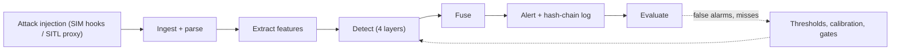

# Drone Intrusion Detection System

**PUSHPAK Grand Challenge 3: Security of Drones, Objective 2 — Stage 2: Detailed Evidence-Supported IDS Report**

> **Draft status (2026-10-29).** Structure and headings follow the official template (`docs/Stage 2_Security of Drones, Objective 2_Report Template.pdf`).
> Every number is tagged **`SIM`** (in-process simulator) · **`REPLAY`** (recorded logs, offline) · **`SITL`** (live software-in-the-loop) ·
> **`BENCH`** (physical autopilot, disarmed and stationary per its own telemetry, receive-only; placement and props were not recorded for the 2026-10-28 capture) and carries the artifact it came from. **`[TBD]`** marks a human field or
> evidence that does not exist; it is never filled with an estimate. **No data from the team's own flight and no attack against a real
> vehicle exist.** The audit behind this draft is `docs/SUBMISSION_READINESS_AUDIT.md`; the evidence ledger is `docs/VALIDATION_EVIDENCE.md`.
> Figures that earlier existed only in prose (benchmark re-runs, session-level intervals, the GPS-drift magnitude sweep) are regenerated, with commands and hashes, in
> `artifacts/validation/submission_rerun_20261029/` (all `SIM`; its README states what each file is and is not).

## Team and Submission Information

| Particular | Details |
|---|---|
| Team ID | `[TBD]` |
| Team Name | Team Ardra |
| Date of Submission | `[TBD]` |
| IDS Name / Version | AegisFlight 0.1.0 (`pyproject.toml`); commit `[TBD at freeze]` |

---

## 1. Executive IDS Summary [5 Marks]

AegisFlight is a passive, explainable UAV intrusion detection system. It reads MAVLink telemetry, extracts features, runs four detectors
(rules, physics, a learned model, firmware integrity), fuses them into one explained alert and writes it to a SHA-256 hash-chained log. In
Stage 2 it moved from an in-process simulator to live MAVLink ingestion from PX4 and ArduPilot SITL and from a physical autopilot read
receive-only. **Confidence is limited:** detection of attacks is shown on the simulator and on SITL link-level harnesses; the only real-vehicle
evidence is receive-only (no attack, no flight). The "defense" / "prevention" layer is a simulation-only model: on every live source the IDS only reports,
and no prevention effect was measured.

| Parameter | Final Stage 2 Value | Unit | Evidence / Section Reference |
|---|---|---|---|
| IDS name and version | AegisFlight 0.1.0 | -- | `pyproject.toml` |
| Attack classes covered (GPS spoofing, MAVLink anomalies, command injection, telemetry manipulation, DoS, firmware integrity) | 6 implemented and scored on `SIM`; `SITL` link-level harnesses: 3 direct (GPS spoofing, command injection, DoS) + 1 indirect (MAVLink anomalies, via replay/impersonation sequence continuity); none for telemetry manipulation or firmware integrity | count | §5.2; `docs/VALIDATION_EVIDENCE.md` §1d |
| Detection layers (rules, physics, statistics, learned model) | 4 detectors: protocol rules, physics consistency, ML anomaly (Isolation Forest + diagonal Mahalanobis), firmware integrity; fused by noisy-OR. ML is off by default on live non-SIM sources | count | §4, §5.1; `configs/detector.yaml` |
| Autopilot platforms tested (ArduPilot, PX4) | 2 in `SITL` (PX4 `v1.18.0-rc1-27-gc239c63807`, ArduCopter 4.7.1); 1 physical ArduPilot-family autopilot, `BENCH`, receive-only; 0 in flight | count | §8.2; `artifacts/sitl/`, `artifacts/ardupilot/`, `artifacts/hardware/` |
| Placement (onboard, companion computer, ground station, tap) | Passive receive-only tap on the telemetry link, on a ground laptop (`BENCH`). Companion-computer placement is a design target, **not tested** | -- | §3, §9 |
| Telemetry messages monitored | 8 message types: HEARTBEAT, SYS_STATUS, GPS_RAW_INT, GLOBAL_POSITION_INT, ATTITUDE, VFR_HUD, COMMAND_LONG, EKF_STATUS_REPORT (+ link metadata: sequence, source, signature) | count | `src/aegisflight/features/extractor.py`; §6.1 |
| Detection accuracy on data not used for tuning | **No flight data and no independent data: design evidence only.** `SIM`, extended benchmark (thresholds/model not re-tuned on its results, but the simulator, the attacks and the detectors are all the team's): accuracy 0.9771, recall 0.8891, FPR 0.0010 with the 5 s post-attack grace and **0.0110 with no grace**; benign link-stress sessions false-alarm heavily (`link_fifo_benign` FPR 61.28 %, `link_reorder_benign` 99.97 %). **The committed artifact dates from 2026-09-24 (pre-Stage-2 code); a re-run on the submitted tree on 2026-10-29, saved in `artifacts/validation/submission_rerun_20261029/extended_rerun/`, gives identical 5 s-grace counts and no-grace FPR 0.0108 (463 FP); see §5.3.** The Stage-1 baseline (0.997 / 0.990) is on the data the thresholds were built around | % | `artifacts/benchmarks_extended/summary.md`; §5.3 |
| False-alarm rate on benign flights | **Not established as a per-hour rate.** `BENCH`: 0 alerts in 451 decisions (90 s). `REPLAY` real logs: see §7 | per hour | §7 |
| Benign flight time and distance tested | Own flights: **0 h / 0 km**. `BENCH`: 4 captures of 60–90 s, stationary. `REPLAY` of public logs (not ours): author-labelled benign ≈ 0.64 h (ALFA, derived, §7); unlabelled or mixed logs: ALFA 7.66 h total, PX4 Flight Review 2.18–2.36 airborne h (no benign labels) | h / km | §7 |
| Median and 95th-percentile detection latency | `SIM` baseline mean 0.361 s, p95 1.400 s (median not reported); per-mode median/max in §5.3. `SITL`: ArduPilot drift +2.69 s; PX4 drift at release only | ms or s | `artifacts/benchmarks/summary.md`; `artifacts/benchmarks_extended/summary.md` |
| Target hardware used for resource measurement | **None** (no companion computer). Host: Windows 11, Intel i5-11400H (6C/12T), 15.7 GB | -- | §9 |
| CPU use and memory on that hardware | **Host only:** live runner on real bytes, 90 s: 2.78 % of one core, peak RSS 60.7 MB, ML off | % core / MB | `artifacts/hardware/gps_hw_verify_20261029/live_capture/summary.json` |
| Tests included in the submitted archive / passing | 910 Python tests collected (unit 811, integration 92, e2e 2, backend 5) + 11 frontend. **Run on the 2026-10-29 tree: 907 passed, 3 skipped, 0 failed** (155.3 s, Windows, CPython 3.13.15; saved in `artifacts/validation/submission_rerun_20261029/test_suite_run.json`). Not yet run on a clean machine | count | `docs/TESTING.md`; §8.2 |
| Real flight-log hours used | 0 h of the team's own flights. **Public real logs replayed:** 7.66 h (ALFA, fixed-wing, physical faults) + 2.18–2.36 h airborne (PX4 Flight Review, navigation probe) | h | `artifacts/external/alfa/summary.md`; `artifacts/external/px4_review_v2/summary.md` |
| Alert integrity mechanism (signing, hash chain) | SHA-256 rolling hash chain over alerts (`aegis verify-log`); **not signed**. MAVLink-2 signature verification rule exists (`SITL`, PX4, n = 10) | -- | `src/aegisflight/logging/store.py`; `artifacts/sitl/P4_signing_summary.md` |
| Runs fully offline? | Yes. The monitor and dashboard need no network (no map tiles). Fetching datasets does | Yes / No | `frontend/src/components/MapPanel.tsx` |

**Top three reasons why the IDS is considered ready for extended flight trials *in receive-only mode*:**
1. It is passive by construction: `bytes_sent` is 0 on every physical capture, the runner exits non-zero if it ever transmits, and the live
   defense layer is report-only (`tests/unit/test_defense_safety.py`). It does not transmit (software-enforced); physical TX-line isolation and the DTR/RTS side effect of opening the port are **not** verified, so no claim is made that it cannot affect the link.
2. The same unchanged pipeline ingests real streams from PX4 and ArduPilot (5,130 frames with 0 CRC/gap/disconnect on hardware, `BENCH`) and its
   alerts carry the telemetry that caused them and land in a verifiable hash chain.
3. Failures are documented and acted on, not hidden: Stage-1 thresholds were shown not to transfer to real links and were calibrated; four
   `GPS_SPOOFING` alerts that the Stage-1 rule raised on a *replayed* stationary bench capture (receiver wander; cause undetermined) were judged by the team to be non-attacks and
   gated. That judgement rests on the vehicle's own near-zero velocity and the operator's statement, both from an unauthenticated stream; the gate was developed on that capture, so "0 alerts" there is
   not evidence that spoofing is detected or prevented, and the gate also suppresses the rule while the status says "no solution" (§5.1). The open gaps are listed in §5.1.

**Top three remaining uncertainties or risks:**
1. **No attack has been run against, or detected on, a real vehicle, and the team has no flight data.** All attack detection is `SIM` or `SITL` link-level.
2. **No capture with a healthy hardware estimator** (all four have no horizontal position solution), so the un-gated branch has never run on a hardware stream; the gate's tuning is in-sample.
3. **Nothing was measured on a companion computer**, and the false-alarm rate per hour cannot be bounded with the exposure available (§7).

---

## 2. Stage 1 Baseline and Design Evolution [8 Marks]

| Item | Stage 1 Value / Approach | Stage 2 Value / Approach | Change Made? Yes / No | Reason / Evidence |
|---|---|---|---|---|
| Attack classes covered | 6 classes (simulated modes) | same 6; 20 modes in the extended benchmark; `SITL` harnesses: 3 direct + 1 indirect | Yes | `artifacts/benchmarks_extended/summary.md`; `docs/VALIDATION_EVIDENCE.md` §1d |
| Detectors and layers | 4 detectors, noisy-OR fusion | same 4; physics gains an **estimator-aware gate**; protocol gains a **signature-verification rule** and a **coverage-not-attack** policy for absent position | Yes | real bench false alarms: `docs/HARDWARE_BENCH_PIXHAWK6X.md` §6.8–6.10; `artifacts/sitl/P4_signing_summary.md` |
| Platforms and protocols | simulated MAVLink only | + PX4 SITL, ArduPilot SITL, physical ArduPilot-family autopilot (receive-only), MAVLink 1 and 2, tlog + ULog adapters | Yes | §8.2 |
| Data used for validation | synthetic simulator | + ALFA real logs, PX4 Flight Review logs, SITL traces, 4 bench captures | Yes | `data/external/manifests/`; `artifacts/external/` |
| Detection accuracy | 0.997 acc / 0.990 recall (`SIM`, 23,430 decisions) | `SIM` extended 0.977 / 0.889 (116 sessions, 20 modes; committed 2026-09-24, scratch re-run on this tree 2026-10-29 agrees on the 5 s-grace rows); no real-attack accuracy | Yes | `artifacts/benchmarks*/summary.md` |
| False-alarm rate and benign exposure | FPR 0.0002 (`SIM`) | production thresholds false-alarm on every decision of a real link; calibrated profile reduces it; hardware 0 alerts / 451 decisions | Yes | `artifacts/external/alfa/summary.md`; `alfa_calibrated`; `docs/CALIBRATION_PX4.md` |
| Detection latency | mean 0.36 s / p95 1.40 s (`SIM`) | unchanged `SIM`; `SITL` per variant | No (SIM) | `artifacts/benchmarks/summary.md`; `artifacts/sitl/` |
| Compute footprint and hardware | host only (17.7 ms mean decision, ML on) | + live runner on host: 0.35 ms mean decision, 60.7 MB peak (ML off); companion computer **not measured** | Yes (host) | §9 |
| Alerting and logging | SQLite hash chain, dashboard | + receive-only runner outputs (`alerts.jsonl`, `health.jsonl`, `summary.json`), passive `navigation_health` | Yes | `scripts/hardware/run_serial_ids.py` |
| Integration approach | in-process | live source behind the same `IDSPipeline`; additive, Stage-1 benchmark unchanged (6535 / 4 / 16826 / 65) | Yes | `docs/ARCHITECTURE.md`; manifest `checks` |
| Architecture | simulator → IDS → dashboard | + serial / UDP / replay sources, receive-only tap, status-only health observer | Yes | §3 |

### 2.1 Stage 1 Claims Revisited

| Stage 1 Claim | Demonstrated / Partly / Withdrawn | Reason | Supporting Evidence |
|---|---|---|---|
| Detectors read only observed messages; labels only score | Demonstrated for `SIM`, five attack classes (not firmware integrity) | (1) behavioural: the same attacked session processed with and without its ground-truth fields gives identical decisions, and every class does raise threat decisions, so the check is not vacuous; (2) structural: no detector/feature/fusion module imports the simulator, attacks, benchmark, metrics or ground-truth types. A text search is not relied on (it has one comment-only hit, `features/extractor.py:70`). Live sources carry no labels at all | `tests/unit/test_label_independence.py` (8 tests) |
| Accuracy 0.997, FPR 0.0002 | Partly | true on the simulator; **did not transfer** to real or SITL links with the Stage-1 configuration | `artifacts/external/alfa/summary.md` (100 % threat rate, production config); `artifacts/sitl/P1_summary.md` |
| Compute 17.7 ms / 23.6 ms, "comfortably targets a companion computer" | Partly | host figures stand; the companion-computer statement is **withdrawn** (never measured) | `artifacts/benchmarks/summary.md`; `docs/ONBOARD_DEPLOYMENT.md` |
| Memory ≤ 158 MB | Partly | host, ML on, `SIM`; live runner 60.7 MB, ML off | `artifacts/benchmarks/summary.md`; `live_capture/summary.json` |
| "44-test suite" | Superseded | 910 tests now | §8.2 |
| Future: validate on ArduPilot/PX4 SITL | Demonstrated | live ingestion equals offline replay per decision; SITL attack harnesses | `artifacts/sitl/live_run_002_equivalence.json` |
| Future: hardware-in-the-loop on a companion computer | Not done | no HITL, no companion | -- |
| Future: MAVLink-2 signing verification | Partly | PX4 SITL, one force-disarm command on a disarmed vehicle: forged unsigned command rejected by PX4 10/10 and flagged by the IDS rule 10/10 (pre-onset: 10/400 decisions on the signing rule, 307/400 on any rule). Replay of a *signed* frame, other commands, key management and trust-on-first-contact are not addressed | `artifacts/sitl/P4_signing_summary.md` |
| Future: per-airframe calibration | Partly | PX4 SITL profile (1 false alarm in 2,805 held-out decisions); ALFA one-parameter calibration | `docs/CALIBRATION_PX4.md`; `artifacts/external/alfa_calibrated/summary.md` |
| Future: multi-vehicle support, hardened deployment | Not done | -- | -- |

### 2.2 Stage 1 Open Questions Addressed

| Open Question from Stage 1 | How Addressed in Stage 2 | Result / Evidence | Remaining Uncertainty |
|---|---|---|---|
| `[TBD]` — the Stage-1 evaluator questions are not in the repository; insert them here | `[TBD]` | `[TBD]` | `[TBD]` |
| Interpretation of **"distance covered"** | The pipeline reports *simulated path length*: the sum of haversine steps between **reported** positions (`LiveEngine._accumulate_distance`, the same method as the benchmark's `_distance_m`). It is not odometry and not ground truth | `SIM` baseline mean 1,145.8 m per flight (`artifacts/benchmarks/summary.md`). On `BENCH` a stationary board showed 196 m because GNSS wander accumulates as path | On a vehicle with a weak fix the measure is inflated by wander; **no kilometre figure is reported for any real data** (§7) |

---

## 3. Updated/Implemented Requirements and Architecture [7 Marks]

| Requirement / Target | Challenge Target | Final Team Target | Status / Comment |
|---|---|---|---|
| Attack coverage | Detect the six attack classes: GPS spoofing, MAVLink anomalies, command injection, telemetry manipulation, denial of service, firmware integrity | `[TBD — team to set]` | All six detected on `SIM`; `SITL` link-level: 3 direct + 1 indirect harnesses, none for telemetry manipulation or firmware integrity; known gaps in §5.1. Not shown on a real vehicle |
| Detection accuracy | High detection across attack scenarios, including subtle attacks | `[TBD]` | `SIM` extended recall 0.889; subtle GPS drift below ~4 m/s and velocity-consistent drift are **not** detected (pinned by tests) |
| False alarms | Low false-alarm rate on benign flight | `[TBD]` | `SIM` FPR 0.0002 (baseline) / 0.0010 (v2); real links need per-vehicle calibration; no per-hour rate |
| Latency | Timely alerts, fast enough to act on | `[TBD]` | `SIM` mean 0.36 s, p95 1.40 s; decision cadence 200 ms. Advisory use only |
| Compute | Low overhead on flight-compatible hardware | `[TBD]` | host 2.78 % of one core; **companion computer not measured** |
| Integration | Works with ArduPilot and PX4 and a ground station without degrading flight | `[TBD]` | passive tap, `bytes_sent` 0; PX4 and ArduPilot in `SITL`, ArduPilot-family on `BENCH`; no flight |
| Alert security | Tamper-evident alerts and logs | `[TBD]` | SHA-256 hash chain (unsigned); `aegis verify-log` |
| Design outcome | Validated, deployable IDS | `[TBD]` | **Validated on simulator, SITL and bench streams; not validated in flight; not deployed** |

**Final architecture.** *Data sources and tap point:* the monitored link is the autopilot's telemetry stream (MAVLink 1 or 2), received over a serial
telemetry radio or UART (`BENCH`), UDP (`SITL`), or a recorded tlog (`REPLAY`). *Pre-processing:* `SerialMavlinkTransport` frames and CRC-checks bytes
(resynchronises on garbage, counts rejects); `LiveMavlinkSource` turns frames into 200 ms ticks. *Feature extraction:* `FeatureExtractor` →
`FeatureFrame` (`docs/FEATURES.md`). *Detection layers:* protocol rules, physics consistency, ML anomaly (off on live non-SIM sources by default),
firmware integrity. *Fusion:* noisy-OR with weights 0.30 / 0.34 / 0.16 / 0.20 and a 0.45 threat threshold (`configs/detector.yaml`). *Alerting and
logging:* alerts at severity ≥ SUSPICIOUS, 4 s cooldown per attack type, SQLite hash chain, `alerts.jsonl`, FastAPI + WebSocket → React dashboard.
*Interfaces:* `/api/status` (includes the passive GPS/estimator health block), `/ws`, `aegis verify-log`. *Where it runs:* a ground laptop in
the tested configuration; a companion computer is a design target.
**How it avoids interfering with flight control:** the serial runner has no mode that transmits (`active-ips` is refused on live sources); it fails with
exit 3 if any byte is written; `bytes_sent` was 0 in every physical capture. The monitored radio link is bidirectional, but the laptop side never writes
to it. *Not verified:* physical TX-line isolation on a companion harness (design only, `RISK_REGISTER.md` RSK-01) and the DTR/RTS side effect of opening the port.
The defense/mitigation layer (counter-commands, sanitiser, dashboard "prevention") is a **`SIM` model**; no prevention metric was measured.

```mermaid
flowchart LR
  FC["Autopilot (ArduPilot / PX4)"] -- "telemetry radio / UART, MAVLink 1 or 2" --> RX["Laptop serial port (RX only)"]
  RX --> TR["SerialMavlinkTransport: frame, CRC, resync"]
  TR --> TAP["TapTransport: optional raw tlog copy"]
  TAP --> SRC["LiveMavlinkSource: 200 ms ticks"]
  SRC --> OBS["GpsHealthObserver (status only)"]
  SRC --> FE["FeatureExtractor -> FeatureFrame"]
  FE --> D["Protocol | Physics | ML (off live) | Integrity"]
  D --> FU["FusionEngine: noisy-OR"]
  FU --> ST["EventStore: SQLite SHA-256 hash chain"]
  FU --> OUT["alerts.jsonl / health.jsonl / summary.json"]
  OBS --> OUT
  ST --> API["FastAPI /api/status, /ws"] --> UI["React dashboard"]
```

*Figure source (Mermaid); render to an image before submission. `[TBD: rendered figure]`.* Stage-1 architecture sources: `docs/diagrams/*.mmd`.

---

## 4. Integrated Methodology and Workflow [8 Marks]

*Source only; render before submission. `[TBD: rendered figure]`.*

| Sub-domain | Tool / Code / Method | Main Inputs | Main Outputs | How Verified / Checked |
|---|---|---|---|---|
| Data ingestion and parsing | `mavlink/`, `sources/mavlink_serial.py`, `sources/mavlink_live.py`, `external/{tlog,ulog}_adapter.py` | serial bytes, UDP datagrams, tlog / ULog | `MessageEnvelope` + link stats | `tests/unit/test_mavlink_*.py`; hardware: 5,130 frames, 0 rejects (`BENCH`); loopback equivalence `artifacts/sitl/live_run_002_equivalence.json` |
| Feature extraction | `features/extractor.py` | envelopes | `FeatureFrame` | unit tests; `docs/FEATURES.md` |
| Detection layers | `detectors/{protocol,physics,anomaly,integrity}.py` | `FeatureFrame` only | per-detector score, votes, evidence | `tests/unit/test_gps_scenarios_fused.py` (79), `test_missing_telemetry*.py`; benchmarks |
| Fusion and alert policy | `fusion/engine.py`, `configs/detector.yaml` | detector results | `ThreatAssessment` | `tests/unit/test_fusion_and_metrics.py` |
| Alerting and logging | `logging/store.py`, `backend/`, `scripts/hardware/run_serial_ids.py` | assessments | SQLite chain, JSONL, API | `tests/unit/test_integrity_and_logging.py`; `aegis verify-log` |
| Attack injection and test generation | `attacks/` (SIM hooks), `proxy/` (SITL MITM), `benchmark/` | simulator state, live frames | labelled sessions / frame logs | `tests/unit/test_proxy_*.py`, `test_attacks_extended.py`; ground truth is the attack's own log, never visible to detectors |
| Metric computation | `metrics/`, `benchmark/`, `scripts/{benchmark,external_validation,make_validation_table}.py` | decisions + labels | confusion counts, recall, latency | regression: 6535 / 4 / 16826 / 65 reproduced on each change set recorded in `docs/VALIDATION_EVIDENCE.md` (§1c–1e) and on 2026-10-29 |

**How results from one stage changed another (all documented):** (1) real-link false alarms on ALFA and PX4 SITL showed the Stage-1 rate/ML features did not
transfer → per-vehicle calibration profile; (2) bench captures showed a never-received position stream was reported as a CRITICAL `DOS` → "coverage, not
attack" policy, start-up alert removed; (3) a stationary vehicle in constant-position mode produced `GPS_SPOOFING` alerts that the team judged false (stationary per the vehicle's own velocity and the operator; unauthenticated) → estimator gate v2 (tuned on that capture); (4) 5/10 command-injection
detection was a harness defect (relay did not mirror a hook-added frame), not a detector → harness fixed, re-run 10/10; (5) an outage produced a burst of false alerts
at recovery → extractor link-gap fix; (6) the dashboard said "valid fix yes" on an unhealthy vehicle → passive `navigation_health` block (§6, §7).

---

## 5. Detection Methodology and Attack Coverage [18 Marks]

### 5.1 Methodology

| Item | Details |
|---|---|
| Detectors per attack class | **GPS spoofing:** physics (position-vs-velocity residual, jump, GPS/VFR speed, GPS/baro altitude); **MAVLink anomalies:** protocol (rate, jitter, sequence gap, rogue source, signature) + ML; **command injection:** protocol (source identity, cadence, state); **telemetry manipulation:** physics (altitude/speed/attitude/battery consistency) + ML; **DoS:** protocol (heartbeat/GPS dropout, GNSS fix loss, rate); **firmware integrity:** integrity (SHA-256 manifest). Fusion attributes one primary class. Source: `docs/DETECTION.md` |
| Inputs read by each detector | Only `FeatureFrame` fields (`docs/FEATURES.md`): protocol = rates, jitter, sequence gaps, sources, heartbeat/GPS age, commands, signature counts, GNSS fix/satellites; physics = position residual, speed/altitude/yaw-course differences, acceleration, battery rise, EKF-derived gate fields; ML = 11 `ML_FEATURES`; integrity = firmware manifest hash. **None reads ground truth, attack flags or labels, as far as tested:** `tests/unit/test_label_independence.py` shows identical decisions with and without the ground-truth fields on `SIM` sessions of five attack classes, and that no detector, feature or fusion module imports the simulator, attacks, benchmark or ground-truth types. Not covered: the firmware-integrity class (the integrity detector reads the firmware directory by design), other seeds, and anything beyond `SIM`. A plain `grep` is not proof (it has one comment-only hit) and is not used as such |
| Thresholds and training | Thresholds are hand-set in `configs/detector.yaml` against the Stage-1 simulator. ML: Isolation Forest + diagonal Mahalanobis trained on **benign simulator sessions only** (`aegis train`; `models/isoforest.joblib` is git-ignored). Split: `SIM` benchmark = unseen noise realisations of the training trajectories; extended v2 = new trajectories/routes/speeds ("nothing tuned on these results"). **Not** a whole-flight real-data split. PX4: profile fitted on calibration flights, evaluated on held-out flights (`docs/CALIBRATION_PX4.md`); ALFA: calibration dates vs held-out dates |
| Decision logic | Detector scores → noisy-OR fusion (0.30 / 0.34 / 0.16 / 0.20) → threat if ≥ 0.45 → alert if severity ≥ SUSPICIOUS, 4 s cooldown per class, 4 normal ticks to clear. Rules are persistence-gated (e.g. GNSS fix lost needs 5 decisions). Live runner is advisory: it reports and never acts |
| Latency design | Decision cadence 200 ms (5 Hz), so a single-frame rule alerts within one tick; the position residual uses a 15-fix window (so slow drift needs seconds); GNSS-loss persistence ≈ 1 s. Compute per decision: 17.7 ms mean (ML on, `SIM`) / 0.35 ms (ML off, live `BENCH`) |
| Baseline comparison | **Not done** against a simple threshold or the autopilot's own failsafes. The only comparison is an ML on/off ablation (`artifacts/benchmarks_ablation_no_ml/summary.md`: ML is the only false-positive source in the baseline) |
| Known blind spots | `gcs_replay` / impersonation of the expected GCS identity without signing (0/4 `SIM`; informed forger 0/10 `SITL`); constant offset detected only at the jump (`sudden_offset`, 12.63 % decision recall); GPS drift below ~4 m/s and velocity-consistent drift; PX4 drift detected only at release; forged `EKF_STATUS_REPORT` (the gate can hide a < 30 m/fix walk — only MAVLink-2 signing closes it); firmware-manifest forgery; ML does not transfer across vehicles. `docs/VALIDATION_EVIDENCE.md` §3 |
| Limitations | Detection results are simulated or link-level; attacks were authored by the team; real vehicles were observed only passively; MAVLink-1 links cannot carry `h_acc`; the SIM benchmark has no signing model. **Platform coverage is uneven:** PX4 was exercised only in SITL (n = 3–10 per variant; GPS drift caught at release only) and never on hardware; ArduPilot has SITL drift n = 3 plus one physical ArduPilot-family board observed passively; the ML detector is off on every live non-SIM source, so live detection is rules + physics only. **GPS drift floor depends on the ML state (`SIM`, 10 seeds per rate, gradual drift, true velocity reported):** with ML off (as on live sources) 0/10 sessions flagged at 0.5–3 m/s and 10/10 at 4–12 m/s; with ML on 0/10 at 0.5–1 m/s and 10/10 from 2 m/s, at the price of 1/10 benign sessions with a false-positive decision (`artifacts/validation/submission_rerun_20261029/gps_drift_sweep_ml_{off,on}/`). Velocity-consistent drift and a constant offset after the jump are not detected in either state |

### 5.2 Attack Coverage and Test Matrix

| Attack class | Scenarios (count, magnitude range, including subtle) | Flight evidence used (flight log, live telemetry, replay) | Injection method and ground-truth source | Detected / total |
|---|---|---|---|---|
| GPS spoofing | `SIM`: 3 modes (gradual drift, replay-freeze, sudden offset) × 4 sessions; subtle drift pinned by tests (0.5 and 2 m/s **not** flagged; ≥ ~4 m/s flagged). `SITL`: PX4 10 trials, 2.4–9.3 m/s, 15–38 s; ArduPilot 3 trials, 5 m/s × 25 s | none in flight. Real logs replayed for false alarms only | `SIM`: attack hooks, `Attack.label(t)`. `SITL`: live proxy rewrites `GLOBAL_POSITION_INT`; ground truth = proxy frame log | `SIM` 12/12 sessions (decision recall 94.6 % / 97.4 % / **12.6 %**); PX4 10/10 **at release only**; ArduPilot 3/3 (+2.69 s) |
| MAVLink anomalies | `SIM`: rogue sysid, rate spike, packet loss, sequence scramble × 4 sessions. `SITL`: indirect (replay and impersonation) only | none | hooks; proxy for `SITL` | `SIM` 16/16 sessions; `SITL` live harness for rogue-sysid/rate/scramble **not run** |
| Command injection | `SIM`: arm-disarm burst, gcs_replay, mode flip, rogue command × 4. `SITL`: rogue-sysid `COMMAND_LONG` 10 trials (37 frames); replay 10; impersonation naive 10 / informed 10; signing 10 | none | proxy injects on the uplink; ground truth = proxy frame log + carrier log | `SIM` 12/16 (`gcs_replay` 0/4, known gap); `SITL` rogue 10/10, replay 10/10 (sequence continuity), naive 10/10, **informed 0/10**, signed forgery rejected 10/10 |
| Telemetry manipulation | `SIM`: altitude bias, battery jump, frozen attitude, speed mismatch × 4 | none | hooks | `SIM` 16/16 sessions (frozen attitude 69.1 % recall, median 4.5 s, max 18.8 s); **no `SITL` harness** |
| Denial of service | `SIM`: blackout, flood, GNSS jamming, latency × 4. `SITL`: drop 10, delay 10, GNSS-fix degradation 10 | none | hooks; proxy | `SIM` 16/16 sessions; `SITL` drop 10/10, delay **9/10**, GNSS 10/10 (positive control, gross degradation only) |
| Firmware integrity | `SIM`: tampered component × 4 sessions (baseline recall 0.991) | none | hook alters the firmware directory | `SIM` 4/4; **no `SITL` analogue**; manifest unsigned |

Sources: `artifacts/benchmarks_extended/summary.md`, `artifacts/sitl/P2_*_summary.md`, `P4_signing_summary.md`, `artifacts/ardupilot/`, `docs/VALIDATION_EVIDENCE.md` §1b–1d.
`SITL` batches are n = 3–10 per variant: they show the harness works, not a rate. **The 10/10-style counts above are the original batches**, run on earlier code with a dirty working tree
recorded in each manifest ("not a clean-commit reproduction", `P2_injection_summary.md`; P4 signing likewise). The final-code, clean-tree smoke batches are **n = 3** each
(PX4 drift 3/3 at release only, injection 3/3, replay 3/3, drop 3/3, delay 3/3, GNSS 3/3; ArduPilot drift 3/3): `docs/VALIDATION_EVIDENCE.md` §1d.

### 5.3 Required Outputs

| Output | Required Content | Result |
|---|---|---|
| Detection accuracy | per-class and overall counts **with confidence intervals**, on untuned data | Counts: baseline 6535 / 4 / 16826 / 65 over 23,430 decisions (`artifacts/benchmarks/summary.md`); extended v2, 5 s grace: 9088 / 39 / 40813 / 1133 over 51,073; **no grace: 9088 / 470 / 42209 / 1133 over 52,900 (FPR 0.0110)**; benign link-stress sessions: `link_fifo_benign` FPR 61.28 % (6 of 6 sessions with a false positive), `link_reorder_benign` 99.97 % (`artifacts/benchmarks_extended/summary.md`; committed 2026-09-24 on pre-Stage-2 code). **Re-run on the submitted tree, 2026-10-29, saved in `artifacts/validation/submission_rerun_20261029/extended_rerun/` (`scripts/benchmark_extended.py --out <scratch> --workers 4`; the committed `artifacts/benchmarks_extended/` is left as it was): 5 s-grace rows identical; no grace 9088 / 463 / 42216 / 1133 (FPR 0.0108); benign link-stress rows identical; the only per-mode change is `dos:blackout` (post-attack tail 1.6 s, attribution 93.30 % vs 1.9 s / 81.26 %).** **Confidence intervals (`SIM`, session level, Wilson 95 %, not decision level because decisions inside a session are correlated; n = sessions; `artifacts/validation/submission_rerun_20261029/extended_rerun/stats/session_ci.md`):** GPS spoofing 12/12 [0.76, 1.00]; MAVLink anomalies 16/16 [0.81, 1.00]; command injection **12/16 [0.51, 0.90]** (`gcs_replay` 0/4 [0.00, 0.49]); telemetry manipulation 16/16 [0.81, 1.00]; DoS 16/16 [0.81, 1.00]; firmware integrity 4/4 [0.51, 1.00]; composites 12/12 [0.76, 1.00]. Benign sessions with ≥ 1 false-positive decision: 4/12 [0.14, 0.61]; link-stress benign 6/6 and 6/6 [0.61, 1.00]. With 4 sessions per mode these intervals are wide and a "12/12" does not mean a high detection probability. No interval exists for any flight, real-attack or `SITL` rate other than what n = 3–10 trials implies (not computed) |
| Subtle-attack results | detection against magnitude, including near-noise attacks | **GPS gradual drift only, `SIM`** (`artifacts/validation/submission_rerun_20261029/gps_drift_sweep_ml_{off,on}/`, plot `detection_vs_magnitude.png`): ML off: 0/10 sessions at 0.5, 1, 2, 3 m/s, 10/10 at 4–12 m/s; ML on: 0/10 at 0.5–1 m/s, 10/10 from 2 m/s; a step, not a curve, because the injected drift is velocity-inconsistent. The sweep was run after the floor was pinned by `tests/unit/test_gps_scenarios_fused.py`, so it is a characterisation, not validation. No magnitude sweep exists for the other five classes |
| Detection latency | distribution (median, p95) per class | `SIM` baseline mean 0.361 s / p95 1.400 s; per-class **min / median / max time to first alert among detected sessions** (`extended_rerun/stats/latency_by_class.md`): GPS spoofing 0.0 / 0.5 / 1.2 s; MAVLink anomalies 0.0 / 0.0 / 0.4 s; command injection 0.0 / 0.2 / 0.4 s; telemetry manipulation 0.0 / 0.1 / 18.8 s (`frozen_attitude` median 4.5 s); DoS 0.0 / 0.0 / 0.8 s; firmware integrity 0.2 / 0.5 / 0.8 s. A 95th percentile is **not** reported: no class has 20 detected sessions. Decision cadence is 0.2 s, so "0.0" means the first decision after onset. Undetected sessions are excluded from these figures |
| Baseline comparison | against a simple threshold or the autopilot's checks | **Not done** (ML ablation only) |
| Missed detections | every miss listed and explained | `gcs_replay` (4/4 sessions missed: the sender uses the legitimate GCS identity and no signing is modelled); `sudden_offset` (87 % of decisions missed: a consistent offset is only visible at the jump); `frozen_attitude` (31 % missed); baseline 65 FN decisions; PX4 drift (only at release); informed impersonation 0/10; delay 1/10 (smallest delay, too small a backlog) |
| Confidence statement | why the results are trusted, what was not tested | Trusted for: the detectors' behaviour on the stated simulated and link-level scenarios, because the harness, ground truth and regression numbers are reproducible. **Not tested:** any attack on a real vehicle, any flight, wind/turbulence, real RF, a companion computer, a healthy hardware estimator. Results on `SIM` are design evidence |

*Figures:* confusion matrix and per-attack recall exist for the `SIM` baseline: `artifacts/figures/confusion_matrix.png`, `per_attack_recall.png`,
`latency.png` (`SIM`, Stage-1 grid). Detection versus drift magnitude: `artifacts/validation/submission_rerun_20261029/gps_drift_sweep_ml_off/detection_vs_magnitude.png` and `…_ml_on/…`
(`SIM`, GPS drift only). `[TBD: a latency-distribution plot; the per-class tables above are not a distribution plot]`.

---

## 6. Data Sources, Features and Detection Analysis [12 Marks]

### 6.1 Data Sources and Features

| Data source (message / field) | Feature derived | Used by detector | Why it matters | Real-data evidence |
|---|---|---|---|---|
| HEARTBEAT (age, sysid, mode, armed) | `heartbeat_age_s`, `sources` | protocol | link loss, rogue identity | `BENCH` 1 Hz in all captures |
| GLOBAL_POSITION_INT (lat, lon, vx, vy) | `pos_residual_m`, `gps_age_s`, `pos_step_max_m` | physics, protocol | spoofing: reported track vs velocity | `BENCH` 2 Hz; ALFA, PX4 logs (`REPLAY`) |
| GPS_RAW_INT (fix_type, satellites, eph) | GNSS fix/satellite state | protocol | fix loss vs never acquired | `BENCH` 180 reports, 3D, 6–7 sats |
| VFR_HUD (groundspeed, alt) | `gps_vfr_speed_diff_ms`, `gps_baro_alt_diff_m` | physics | speed/altitude consistency | `BENCH` 4 Hz; on real PX4/ArduPilot both are estimator outputs, so independence is lost (`VALIDATION_EVIDENCE.md` §1) |
| ATTITUDE (yaw) | `yaw_course_diff_deg`, accel, jerk | physics | frozen attitude, manoeuvre plausibility | `BENCH` 4 Hz |
| SYS_STATUS (battery, sensor bits) | `battery_v_rise`; GPS present/health bits (health observer only) | physics; `GpsHealthObserver` | battery attack; GPS health | `BENCH` 2 Hz; GPS healthy 0/180 |
| COMMAND_LONG (source, id) | `cmd_rate_hz`, `commands_recent` | protocol | injection, cadence | `SITL` only (none on `BENCH`) |
| EKF_STATUS_REPORT (flags) | `ekf_flags`, `nav_solution`, `nav_gated`, `pos_residual_nav_m` | physics (gate); health observer | degraded navigation is not an attack | `BENCH` 180 reports `0xa7`; 008: 125; 009: 120 |
| MAVLink framing (seq, sysid, signature) | `max_seq_gap`, `msg_rate_hz`, jitter, `signed_ratio`, `sig_invalid` | protocol, ML | replay, rate, loss, forged-signature | `BENCH` 0 gaps; `SITL` P4 |
| Firmware directory (SHA-256) | integrity status | integrity | tamper | `SIM` only; manifest unsigned |

Full catalogue: `docs/FEATURES.md`. ML sees only `ML_FEATURES` (11, frozen order); estimator fields are deliberately outside it.

### 6.2 Detection Capabilities and Robustness

| Capability | Method | Test evidence | Result | Limitation |
|---|---|---|---|---|
| GPS spoofing | residual / jump / speed / altitude rules + estimator gate | `SIM` 79 fused scenarios; `SITL` drift; `REPLAY` real stationary capture | see §5.2; gate: 4 alerts → 0 on one replayed stationary capture; the alerts are judged non-attacks, not proven so; in-sample; the status stream is unauthenticated | slow and velocity-consistent drift; PX4 at release only; forged status |
| MAVLink anomalies (replay, sequence, rate) | per-source sequence continuity, rate, jitter, identity | `SIM`; `SITL` replay | `SIM` 16/16; replay 10/10 | caught only while the real GCS counter advances; informed forger evades |
| Command injection | source identity, cadence, signature | `SIM`; `SITL` 10/10 | rogue sysid flagged; forged GCS rejected when signed | `gcs_replay` / expected-GCS impersonation undetected without signing |
| Telemetry manipulation | cross-channel consistency | `SIM` | 16/16 sessions | no live harness; `frozen_attitude` 69 % |
| Denial of service | dropout, rate, fix loss | `SIM`; `SITL` | drop 10/10, delay 9/10, GNSS 10/10 | gross GNSS degradation only; no real jamming |
| Firmware integrity | SHA-256 compare | `SIM` | 4/4 | manifest unsigned; no live analogue |
| Handling of malformed, truncated or corrupted telemetry | CRC + magic-byte resync; partial-frame timeout; bounded queues; counters | `tests/unit/test_mavlink_serial.py`, `test_mavlink_live*.py`, `test_serial_raw_tap.py` | no crash on garbage / truncated frames in tests; 0 bad frames on hardware (clean link) | **no fuzzing campaign** and no corrupted-frame test on hardware |

### 6.3 Traceability of Alerts

| Alert | Source message(s) and field values | Detector and threshold | How a reviewer checks it |
|---|---|---|---|
| `GPS_SPOOFING`, gate **off** (Stage-1 rule) on a capture of a vehicle stated stationary and disarmed (cause of the receiver wander undetermined), `REPLAY` | `GLOBAL_POSITION_INT` lat/lon steps with velocity ≈ 0; residual 12.0–15.2 m | `physics_consistency`, position residual > 12 m (`physics.gps_pos_residual_m`) | `artifacts/hardware/gps_hw_verify_20261029/replay/live_capture_gate_off_noml.json` (4 alerts, evidence strings); regenerate with the command in that bundle's README |
| Same bytes, gate **on** | `EKF_STATUS_REPORT` flags `0xa7` (CONST_POS) ×180, `SYS_STATUS` GPS healthy 0 | residual not used as spoofing evidence; "degraded navigation" line only | `live_capture_gate_on_noml.json` (0 alerts); `live_capture/gnss_summary.json`. **This is the gate behaving as designed on the capture it was developed on. It is not evidence that spoofing would be detected, or that the position was authentic** |
| `COMMAND_INJECTION` (`SITL`) | `COMMAND_LONG` from sysid 66 / compid 200 | `protocol_rule`, unexpected source identity | `artifacts/sitl/P2_injection_summary.md` (10/10; 37/37 frames) |
| Vehicle-stated health (not an alert) | `navigation_health` in `summary.json` / `health.jsonl` | `GpsHealthObserver` flags; no threshold | `artifacts/hardware/gps_hw_verify_20261029/replay/navigation_health_loopback/` |

Every alert stores its evidence strings and detector scores in the event store. `[TBD: figure with the triggering telemetry]`.

---

## 7. False-Alarm Behaviour and Alerting [8 Marks]

| Parameter | Value | Unit | Basis / Evidence |
|---|---|---|---|
| Benign flight time tested | **Own flights: 0.** `BENCH` stationary: 0.025 h live (90 s) + 3 earlier captures of ~60 s. `REPLAY` public logs: ALFA 7.66 h total log time (4.64 h in the calibrated held-out split; **~0.64 h** is author-labelled benign, derived as 11,545 decisions at the 5 Hz implied by 137,926 decisions = 7.66 h); PX4 Flight Review 2.18–2.36 airborne h (**unlabelled** public logs, navigation probe: not counted as benign) | h | `artifacts/hardware/gps_hw_verify_20261029/`; `artifacts/external/alfa*/summary.md`; `px4_review_v2/summary.md` |
| Benign distance tested (definition of "distance covered": §2.2) | **Not reported.** Simulated path length from reported positions is unreliable on a weak fix (196 m for a stationary board) | km | `docs/HARDWARE_BENCH_PIXHAWK6X.md` |
| Number of separate benign flights | Own: 0. `BENCH` captures: 4 (one vehicle, stationary). ALFA: 35 recordings (21 in the calibrated split); PX4 Flight Review: 24–26 usable flights (unlabelled) | count | as above |
| False alarms observed | `BENCH` live: **0 alerts / 451 decisions**. `REPLAY` gate off: 4 `GPS_SPOOFING` / 450 (judged non-attacks by the team, not independently established). ALFA calibrated, author-labelled benign: 18 threat **decisions** of 11,545 (0.16 %; alerts not counted). PX4 SITL calibrated held-out: 1 / 2,805 decisions. **Negative results:** with the Stage-1 production configuration ALFA's author-labelled benign periods are 100 % threat (17,989 decisions); on PX4 Flight Review logs (unlabelled, production thresholds, no tuning) the physics trigger rate is 5.51 % of airborne decisions on `px4_telemetry` and 93.42 % on `independent_sensors`, and yaw/course exceedance is 48 % — transfer failures, not rates (`px4_review_v2/summary.md`). Final-code `SITL` smoke batches: 0 pre-onset alerts in the pooled decisions listed in `VALIDATION_EVIDENCE.md` §1d | count | as above; `docs/CALIBRATION_PX4.md` |
| False-alarm rate | **Not computed.** Alerts are not counted per hour on any real-flight data | per hour | -- |
| Upper 95 % bound on false-alarm rate | **Not established.** For scale only: with 0 alerts in the 0.025 h `BENCH` run the rule-of-three bound is ≤ 120 per hour (derived: 3 / 0.025 h), which shows the exposure cannot support a rate claim (a stationary bench run with autocorrelated decisions: **not** a flight bound) | per hour | derived arithmetic, not an artifact |
| Alert persistence and suppression settings | threat ≥ 0.45; alert at severity ≥ SUSPICIOUS; cooldown 4.0 s per attack type; 4 normal ticks to clear; rule-level persistence (GNSS loss 5 decisions) | -- | `configs/detector.yaml` |
| Alert response policy (advisory or automatic) | **Advisory.** On serial, UDP and replay sources the response is report-only: no counter-frames, `active-ips` refused | -- | `README.md` §2; `tests/unit/test_defense_safety.py` |

### 7.1 Benign-Condition Matrix

| Benign condition | Source (flight log, live telemetry) | Duration | Alerts raised | Assessment |
|---|---|---|---|---|
| Normal cruise | ALFA author-labelled airborne benign, calibrated, `REPLAY` | ~0.47 h derived (8,482 decisions) | 0.21 % of decisions threat | one-parameter calibration needed; production config: 100 % threat rate (does not transfer) |
| Aggressive manoeuvres and mode changes | ALFA unlabelled airborne (mixed), `REPLAY` | 13,092 decisions | 1.34 % threat | not separable from labelled benign; **not assessed as a condition** |
| Wind or turbulence | -- | -- | -- | **not tested** |
| GPS glitch or EKF reset (real) | `BENCH` 008 (fix degraded), `REPLAY` | 313 decisions | 9 → 8 alerts with the gate: 7 correct "GNSS fix lost" `DOS`, 1 altitude-step `TELEMETRY_MANIPULATION` | fix loss is a genuine condition and is reported; the `GPS_SPOOFING` alert was removed (in-sample; its ground truth is the operator's "stationary" statement and the vehicle's near-zero velocity). The 11 `GPS_SPOOFING` alerts of the 2026-10-25 dashboard session saved no bytes, so the gate's effect on them is **unknown** |
| Telemetry link loss and recovery | virtual serial port, 8 s outage, `REPLAY` (not a device) | 1 outage | 1 alert (`sequence gap 218`, true loss) | n = 1; real cable/radio loss not tested |
| Take-off and landing | ALFA (airborne vs ground split) / `SIM` | -- | -- | **not assessed separately on real data** |

### 7.2 Alert Workflow and Integrity

| Alert Stage | Mechanism | Expected Behaviour | Evidence / Plot |
|---|---|---|---|
| Detect | four detectors on each 200 ms `FeatureFrame` | score + evidence | `docs/DETECTION.md` |
| Fuse | noisy-OR, attribution | one primary class, severity | `tests/unit/test_fusion_and_metrics.py` |
| Persist / suppress | threshold 0.45, cooldown 4 s, clear after 4 ticks | no flooding | `configs/detector.yaml` |
| Log | SQLite, each event hashed with the previous hash | any edit or deletion breaks the chain | `tests/unit/test_integrity_and_logging.py`; `aegis verify-log` (chain OK on every run; length 0 on runs with no alerts, so vacuous there) |
| Deliver | `alerts.jsonl`, API, WebSocket, dashboard; optional loopback STATUSTEXT to a GCS | operator sees class, score, evidence | `docs/API.md` |
| Health (not an alert) | `navigation_health` (runner), `link.gps` (API), header note | states vehicle-reported "no horizontal position solution" / "GPS unhealthy" | §6, bundle `navigation_health_loopback/` |

`[TBD: alert timeline figure for a benign flight and an attack flight]`.
**Tamper evidence and IDS failure.** The chain detects insertion, deletion and modification (`broken_at`). It is **not signed**: an attacker who controls the
host can rewrite the whole chain. If the IDS stops, flight is unaffected through the monitored link because nothing is transmitted; the operator loses detection and
the dashboard shows the link as stale. A hardware fail-open for an inline bridge is **not implemented** (the `InlineBridge` watchdog is an in-process software flag, tests only).

---

## 8. Validation, Testing and Reproducibility [14 Marks]

### 8.1 Test Setup

| Item | Details Required |
|---|---|
| Test framework and location | pytest 9.1.1: `tests/unit` (811), `tests/integration` (92), `tests/e2e` (2), `backend/tests` (5) = 910 collected; frontend `node --test` (11) in `frontend/tests/` |
| Data used | **Flight logs from actual flights:** none of ours. Real public logs (REPLAY): ALFA, 35 `.tlog` (manifest + SHA-256 `data/external/manifests/alfa.json`); PX4 Flight Review, 40 ULogs (`px4_review_v2.json`). Live `BENCH`: four COM7 captures (`data/hardware/raw/*.tlog`, git-ignored: they hold the vehicle position). `SITL`: traces committed under `artifacts/sitl/`, `artifacts/ardupilot/`. Generated data is labelled `SIM`. `[TBD: archive location and checksums for the raw captures — P0-5]` |
| Data separation | `SIM`: ML trained on benign simulator sessions, evaluated on new noise seeds (baseline) and new trajectories (extended v2). ALFA: calibration dates vs held-out dates. PX4 SITL: held-out flights never iterated on. Not separated by whole real flight for the ML model |
| Attack generation | By the team, in this repository (hooks in `attacks/`, MITM proxy in `proxy/`). The detector authors had read access to the attack code. Red/blue separation is by module, not by person; extended v2 and the SITL batches were run without tuning on their results. This is disclosed here rather than assumed away |
| Ground truth | `SIM`: `Attack.label(t)` / multi-label; `SITL`: the proxy's own frame/injection log; ALFA: authors' `failure_status`; `BENCH`: none (benign by operator statement; vehicle disarmed and stationary per its own telemetry) |
| Environment | Windows 11, CPython 3.13.15, numpy 2.5.3, scikit-learn 1.9.1, pandas 3.0.6, scipy 1.18.1, pymavlink 2.4.50, pyserial 3.5; `SITL` in WSL2 Ubuntu-24.04, PX4 `v1.18.0-rc1-27-gc239c63807`, ArduCopter 4.7.1. Runs offline |
| Independent re-run instructions | `pip install -e ".[dev]"` · `ruff check src tests scripts backend` · `pytest -q` · `aegis train` · `aegis benchmark --out <scratch> --no-figures` (expects 6535 / 4 / 16826 / 65) · `scripts/ardupilot/replay_ap_tlog.py <tlog> --no-ml` · `aegis verify-log <db>`. External-data replays also need `pip install -e ".[external]"` and `scripts/fetch_external_data.py`. **Pass the `--no-figures` flag**: figures are written to `artifacts/figures/` regardless of `--out` |

### 8.2 Results Summary

| Test Category | Count | Passed | Failed / Skipped | Cause of Failures | Evidence |
|---|---|---|---|---|---|
| Unit tests | 811 | 808 | 0 failed / 3 skipped (POSIX PTY tests, `tests/unit/test_mavlink_serial.py`; no PTY pairs on Windows, `socket://` tests cover the same paths) | -- | full run 2026-10-29, 155.3 s, Windows, CPython 3.13.15: `artifacts/validation/submission_rerun_20261029/test_suite_run.json` |
| Integration / end-to-end | 92 + 2 + 5 = 99 | 99 | 0 / 0 | -- | `pytest tests/integration tests/e2e backend/tests` |
| Replay of recorded flights | REPLAY runs, not counted as tests: ALFA 35 logs, PX4 40 logs, 4 bench captures, 44 byte-identity replays | n/a | n/a | -- | `artifacts/external/`, `artifacts/hardware/`, `artifacts/validation/estimator_gate_v2/` |
| Attack runs during flight operation | **0** | -- | -- | no flight, no attack on a real vehicle | -- |
| Benign-flight runs | own flights 0; `BENCH` captures 4 | -- | -- | -- | `artifacts/hardware/` |
| Cross-platform (ArduPilot / PX4) | `SITL`: PX4 batches n = 3–10 per variant; ArduPilot: 8 live-ingestion flights, 5 benign-reference flights, 3 drift trials | see `VALIDATION_EVIDENCE.md` §1b–1d | open gaps listed there | -- | `artifacts/sitl/`, `artifacts/ardupilot/` |

### 8.3 Claims Traceability

| Claim in this report | Where reproduced (file / test) | Command to reproduce | Result |
|---|---|---|---|
| Baseline 6535 / 4 / 16826 / 65 (`SIM`) | `artifacts/benchmarks/summary.md` | `aegis benchmark --out <scratch> --no-figures` then `scripts/compare_benchmark_runs.py` | identical on the 2026-10-29 tree: TP/FP/TN/FN 6535 / 4 / 16826 / 65; 378 of 378 non-timing `results.csv` cells equal: `artifacts/validation/submission_rerun_20261029/baseline_vs_committed.json` |
| Extended v2 recall 0.8891 (`SIM`) | `artifacts/benchmarks_extended/summary.md`; re-run `artifacts/validation/submission_rerun_20261029/extended_rerun/` | `scripts/benchmark_extended.py` | committed 2026-09-24; saved re-run on the submitted tree 2026-10-29 agrees on the 5 s-grace rows (recall 0.8891) and differs slightly on no-grace FP (463 vs 470); `sessions.csv` identical up to the `detected` column |
| Session-level Wilson intervals, per-class time to first alert (`SIM`) | `artifacts/validation/submission_rerun_20261029/extended_rerun/stats/` | `scripts/make_submission_stats.py --sessions <sessions.csv> --out <dir>` | as in §5.3 |
| GPS drift detection floor, ML off 4 m/s / ML on 2 m/s (`SIM`) | `artifacts/validation/submission_rerun_20261029/gps_drift_sweep_ml_{off,on}/` | `scripts/sweep_gps_drift.py --out <dir> --seeds 10 [--model models/isoforest.joblib]` | as in §5.1, §5.3 |
| Label independence (`SIM`, five classes) | `tests/unit/test_label_independence.py` | `pytest tests/unit/test_label_independence.py` | 8 passed |
| Hardware link: 5,130 frames, 0 rejects, `bytes_sent` 0 (`BENCH`) | `live_capture/summary.json`, `tlog_stats.json` | bundle README "Regenerate" (needs the vehicle) | as committed |
| Receiver 3D ×180, 6–7 sats, healthy 0/180, `0xa7` ×180 (`BENCH`) | `live_capture/gnss_summary.json` | `scripts/hardware/gnss_tlog_summary.py <tlog>` | as committed |
| Gate off 4 alerts / gate on 0 (`REPLAY`) | `replay/live_capture_gate_{off,on}_noml.json` | `scripts/ardupilot/replay_ap_tlog.py <tlog> --no-ml [--config-dir …/cfg_gate_off]` | as committed |
| `navigation_health` flags 452 / 453 decisions (`REPLAY`) | `replay/navigation_health_loopback/` | bundle README | as committed |
| 910 tests collected, 907 passed, 3 skipped | `artifacts/validation/submission_rerun_20261029/test_suite_run.json` | `pytest -p no:cacheprovider -o addopts= -q -rfE` | 907 passed, 3 skipped, 0 failed (this sprint; the earlier 899/902 figures were from before the label-independence tests and are superseded) |
| ALFA production config: 100 % threat rate; calibrated 0.21 % (`REPLAY`) | `artifacts/external/alfa*/summary.md` | `scripts/external_validation.py` (needs fetched logs) | as committed |
| PX4 SITL drift 10/10 at release only (`SITL`) | `artifacts/sitl/P2_summary.md` | `docs/PX4_SITL_INTEGRATION.md` | as committed |
| ArduPilot drift 3/3, +2.69 s (`SITL`) | `artifacts/ardupilot/ap_attack_final_drift_00{1,2,3}/` | `docs/ARDUPILOT_SITL.md` §6 | as committed |
| Forged-GCS commands rejected 10/10 with signing (`SITL`) | `artifacts/sitl/P4_signing_summary.md` | as in summary | as committed |
| Host resources: 2.78 % core, 60.7 MB, 0.349 ms mean decision (`BENCH` stream on a laptop) | `live_capture/summary.json` | bundle README | as committed |

**Validation conclusion.** *Validated on real data (non-attack):* link ingestion and receive-only operation on a physical autopilot; false-alarm behaviour of the
physics layer on public real logs and on four bench captures (in-sample for the gate). *Validated only on generated or simulated data:* detection of all six attack
classes (`SIM`), link-level detection on `SITL`, the defense layer, firmware integrity. *Not validated:* any attack on a real vehicle, flight operation, wind,
a healthy hardware estimator, a companion computer, false-alarm rate per hour.

---

## 9. Compute, Integration, Usability and Reporting [8 Marks]

*Where each measurement was taken is stated. No measurement was taken on target (flight-compatible) hardware.*

| Quantity | Value | Measured on (target / host) | Basis |
|---|---|---|---|
| CPU use at sustained telemetry rate | 2.78 % of one core (mean, 90 s, ML off, 57 msg/s input) | **host** (Windows 11, i5-11400H) | `live_capture/summary.json` |
| Peak memory | 60.7 MB (live runner, ML off); 154.7 MB mean / 158 MB max (benchmark, ML on, `SIM`) | **host** | `live_capture/summary.json`; `artifacts/benchmarks/summary.md` |
| Per-message processing time (median, 99th percentile) | not measured per message. Per **decision**: mean 0.349 ms, p99 0.748 ms, max 1.03 ms (ML off, live stream); 17.7 ms mean / 23.6 ms p95 (ML on, `SIM`) | **host** | as above |
| Sustained messages per second | 57 msg/s processed in real time (= the input rate); benchmark throughput 388 msg/s (`SIM`, ML on) | **host** | as above |
| Headroom at the maximum telemetry rate | **not measured** | -- | -- |
| Power draw and added mass | **not measured** (no companion computer) | -- | -- |

| Item | Selected Approach | Evidence |
|---|---|---|
| Tap point and method (passive tap, router, onboard code) | passive receive-only tap on the ground side of the telemetry link; optional raw `TapTransport` copy | §3; `docs/SERIAL_TRANSPORT.md` |
| Changes required to the flight stack | none to the firmware. Stream-rate parameters (`SRn_*` / `MAVn_*`) must deliver the monitored messages; the operator set them (AegisFlight wrote nothing) | `docs/HARDWARE_BENCH_PIXHAWK6X.md` §6.7 |
| Protocol support (MAVLink 1 and 2, signing) | MAVLink 1 on `BENCH`; 1 and 2 in `SITL`; signature verification rule (opt-in key) | `artifacts/sitl/P4_signing_summary.md` |
| Autopilot support (ArduPilot, PX4) | both in `SITL`; ArduPilot-family on `BENCH`; ML does not transfer to ArduPilot (rules + physics only) | §8 |
| Ground station and dashboard integration | FastAPI + WebSocket → React dashboard; Tauri shell is a prototype outside the tested path; optional loopback STATUSTEXT | `docs/API.md`, `docs/FRONTEND.md` |
| Behaviour if the IDS fails or is overloaded | nothing is transmitted, so flight is unaffected through the link; detection is lost; bounded queues count drops. Hardware fail-open: not implemented | §7.2 |
| Installation and configuration steps | `pip install -e ".[dev]"`; `aegis train`; `aegis serve --source serial …` | `docs/installation.md`, `docs/QUICKSTART.md` |
| Alert delivery and operator view | dashboard, API, `alerts.jsonl`; header shows source (BENCH/REPLAY/SITL/SIM), link state, GPS report and the vehicle-stated health note | `frontend/src/components/Header.tsx` |
| Demonstration video (screen recording of a real run) | **NOT PRODUCED** `[TBD — P0-1]` | -- |

| Quantity | Value | Unit | Basis |
|---|---|---|---|
| Install time on a clean machine | `[TBD: not measured]` | min | -- |
| Time for an operator to interpret a typical alert | `[TBD: not measured]` | min | no usability trial has been run |
| Total cost of the recommended kit | `[TBD]` | INR | no kit has been specified or priced |

Operator-view screenshots (browser render, 2026-10-29, no coordinates on screen): `demo/screenshots/dashboard_SIM_gps_spoofing_gradual_drift.png` (**SIM**, attack injected in the simulator) and
`demo/screenshots/dashboard_REPLAY_bench_capture_gps_health_note.png` (**REPLAY** of the receive-only bench capture: receiver "3D_FIX · 7 sats", autopilot "no horizontal position solution" / "GPS sensor unhealthy"; the threat card reads
"NORMAL" meaning only that no detector fired). `[TBD: rendered integration diagram (§3 figure)]`.

---

## 10. Final Deployable Package [7 Marks]

| Required Item | Submitted? Yes / No | File Name / Section Reference |
|---|---|---|
| Complete source code (in the archive) | Yes (repository) | `src/`, `backend/`, `scripts/`, `frontend/` |
| Installation and user guide | Yes | `README.md`, `docs/installation.md`, `docs/QUICKSTART.md`, `docs/DEMO_RUNBOOK.md` |
| Test suite and instructions to run it | Yes | `tests/`, `docs/TESTING.md` |
| Flight logs and datasets used, with licences | **Partly** | manifests with SHA-256 in `data/external/manifests/`; raw captures and the trained model `models/isoforest.joblib` are git-ignored `[P0-5]`; dataset licences in `docs/EXTERNAL_DATA.md` (PX4 logs: none stated) |
| Attack-injection scripts and ground-truth files | Yes | `src/aegisflight/attacks/`, `src/aegisflight/proxy/`, `scripts/`, `artifacts/sitl/*frames.jsonl` |
| Result files that reproduce the reported numbers | Yes | `artifacts/` |
| Configuration files and thresholds | Yes | `configs/` |
| Demonstration video (real run, not slides) | **No** | `[TBD — P0-1]` |
| Dependency list with licences; third-party code identified | **Partly** | `pyproject.toml` lists dependencies; `LICENSE` (MIT, holder line to be confirmed) and `THIRD_PARTY_NOTICES.md` added 2026-10-29: licences are the packages' *declared* metadata, not audited; Rust crates, Tauri icons, SITL platforms unverified; §11.2 |
| Risk register | Yes (design-intent) | `docs/RISK_REGISTER.md` (corrected 2026-10-29; unsigned) |
| Known limitations and roadmap | Yes | `docs/VALIDATION_EVIDENCE.md` §3–4 |

| Readiness Item | Final Value / Status | Evidence |
|---|---|---|
| Detects all six attack classes in the team's tests? | Yes on `SIM`; `SITL` link-level: 3 direct + 1 indirect harnesses (none for telemetry manipulation or firmware integrity); known gaps in §5.1 | §5.2 |
| False-alarm rate within the team's stated target? | **No target stated; rate not established** | §7 |
| Detection latency within the stated target? | **No target stated**; `SIM` mean 0.36 s, p95 1.40 s | §5.3 |
| Compute within budget on the target hardware? | **Not measured on target hardware** | §9 |
| Runs on an unmodified ArduPilot or PX4 stack? | Yes: passive tap; no firmware change (stream-rate parameters set by the operator) | §9 |
| Alerts and logs tamper-evident? | Yes (hash chain), unsigned | §7.2 |
| Third-party code identified and licensed? | **Partly** (§11.2; no notices file) | §11.2 |
| Operated in flight and ready for extended flight trials? | **Not operated in flight.** Proposed for extended **receive-only** trials | below |

**Final readiness statement.** AegisFlight is a working, tested, passive IDS whose live ingestion, receive-only operation, alert explanation and tamper-evident
logging have been exercised on PX4 and ArduPilot SITL and on a physical autopilot at the bench, and whose detectors behave as documented on the simulator and on
SITL link-level attacks. It has **not** been flown, has not detected an attack on a real vehicle, and has not been measured on flight-compatible compute. We therefore
propose it for extended flight trials in receive-only, advisory mode, where the first objectives are the missing evidence: a benign flight exposure with a
per-hour false-alarm bound, a healthy-estimator capture, and resource measurement on the companion computer. We do not claim immunity to GPS spoofing, prevention, or readiness for autonomous flight.

---

## 11. References, Data Traceability and Integrity [5 Marks]

| No. | Reference / Source | Link / DOI / Datasheet | Application in the IDS |
|---|---|---|---|
| 1 | MAVLink protocol and message definitions (pymavlink dialects) | mavlink.io | framing, CRC, signing, `EKF_STATUS_REPORT` |
| 2 | ArduPilot ArduCopter 4.7.1 and PX4 `v1.18.0-rc1-27-gc239c63807` | ardupilot.org · px4.io | `SITL` platforms |
| 3 | ALFA dataset (AIR Lab Fault and Anomaly) | per `docs/EXTERNAL_DATA.md` | real fixed-wing logs, false-alarm replay |
| 4 | PX4 Flight Review public logs | review.px4.io | real multirotor navigation probe |
| 5 | scikit-learn Isolation Forest | scikit-learn.org | ML detector |

Full list: `docs/REFERENCES.md`. `[TBD: confirm each link/DOI]`.

### 11.1 Software, Digital and AI Tools Used

| Tool | Purpose | Nature / Extent of Use | Team Verification Performed |
|---|---|---|---|
| Claude Code (Anthropic, Claude models) with an Everything-Claude-Code plugin and project subagents | writing and refactoring code, tests, scripts and documentation; running tests and replays; auditing documents | extensive across the repository during Stage 2 (git history) | `[TBD — the team must state what it reviewed, ran and verified by hand]` |
| pytest, ruff, `node --test`, TypeScript compiler | testing, linting, type-checking | all changes | automated gates (§8) |
| Gazebo Sim, PX4 SITL, ArduPilot SITL | simulation | `SITL` runs | recorded per-run manifests |

### 11.2 Third-Party Code and Datasets

Python licences below were read from the installed package metadata on 2026-10-29 (`importlib.metadata`).

| Name | Licence | What Was Used | Where Credited in this Report |
|---|---|---|---|
| pymavlink 2.4.50 | LGPL-3.0 | MAVLink parsing, dialects, signing algorithm | §6, §9 |
| numpy 2.5.3 | BSD-3-Clause (+ bundled permissive) | numerics | §8.1 |
| pandas 3.0.6 | BSD-3-Clause | tables | §8.1 |
| scipy 1.18.1 | BSD | statistics | §8.1 |
| scikit-learn 1.9.1 | BSD-3-Clause | Isolation Forest | §5.1 |
| joblib 1.6.0 | BSD-3-Clause | model persistence | §5.1 |
| psutil 7.2.2 | BSD-3-Clause | CPU/RSS measurement | §9 |
| PyYAML 6.0.3 | MIT | configuration | §3 |
| pydantic 2.13.5 · fastapi 0.142.2 | MIT | API | §3 |
| uvicorn 0.54.0 · websockets 17.2 | BSD-3-Clause | server | §3 |
| matplotlib 3.11.2 | PSF-based | figures | §5.3 |
| pyserial 3.5 | BSD | serial transport | §3 |
| pyulog (optional extra) | `[TBD: not installed here; verify]` | PX4 ULog adapter | §8.1 |
| React 18.3.1, react-dom 18.3.1 (frontend runtime) | MIT (declared in `frontend/package-lock.json`); build tools (Vite, TypeScript Apache-2.0, etc.) are dev-only: `THIRD_PARTY_NOTICES.md` §2 | dashboard | §3 |
| ALFA dataset | "CC BY 4.0" as recorded in `data/external/manifests/alfa.json`; **not re-checked at the source** | real logs, REPLAY | §7 |
| PX4 Flight Review logs | no licence stated (`docs/EXTERNAL_DATA.md`); analysed locally, not redistributed | REPLAY | §7 |
| PX4 Autopilot · ArduPilot · Gazebo | `[TBD: confirm licences; not redistributed]` | `SITL` | §8 |

The repository's own licence is MIT (`pyproject.toml`; `LICENSE` added 2026-10-29 with the holder line "Team Ardra", to be confirmed by the team). `THIRD_PARTY_NOTICES.md` lists the
dependencies, datasets and models and states how each licence was determined; pymavlink is LGPL-3.0 (used as an unmodified library).

### 11.3 Design Integrity Declaration

*To be read, verified and signed by the team. It is deliberately not pre-filled.* The statements most directly testable against this repository: no detector reads
ground-truth labels or attack flags (§5.1, grep); every result is produced by the submitted code (re-run, §8); results labelled `SIM`, `SITL`, `REPLAY`, `BENCH` are
not presented as flight results.

| Particular | Details |
|---|---|
| Team ID | `[TBD]` |
| Team Name | Team Ardra |
| Team Leader Signature | `[TBD — human signature]` |
| Date | `[TBD]` |
